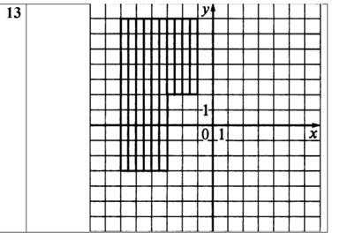
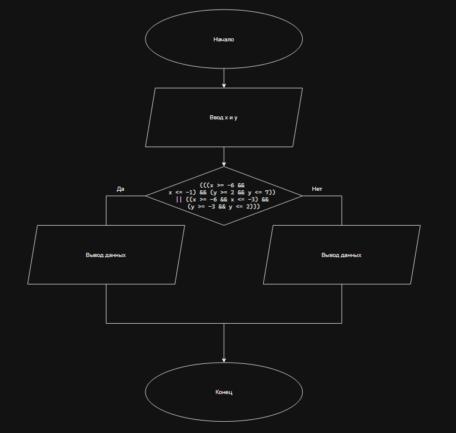

# Домашнее задание к работе 5

## Условие задачи
Составить программу, которая проверяет принадлежит ли заданная пользователем точка с координатами (х, у) заданным закрашенным (заштрихованным) областям, показанным на рисунках в табл., и выводит на экран сообщение.



## 1. Алгоритм и блок-схема

### Алгоритм
1. **Начало**
2. Ввод данных для `x` и `y`
3. Проверка условия принадлежности точки к закрашенной области
  - if (((`x` >= -6 && `x` <= -1) && (`y` >= 2 && `y` <= 7)) || ((`x` >= -6 && `x` <= -3) && (`y` >= -3 && `y` <= 2))) printf("Точка принадлежит закрашенной области\n")
  - else printf("Точка не принадлежит закрашенной области\n")
4. **Вывод результата**

### Блок-схема
 

## 2. Реализация программы

```
#define _CRT_SECURE_NO_WARNINGS
#include <stdio.h>
#include <locale.h>

int main() {
	setlocale(LC_CTYPE, "RUS");

	int x, y;

	printf("Введите координаты x и y\n");
	scanf("%d %d", &x, &y);

	if (((x >= -6 && x <= -1) && (y >= 2 && y <= 7)) || ((x >= -6 && x <= -3) && (y >= -3 && y <= 2))) printf("Точка принадлежит закрашенной области\n");
	else printf("Точка не принадлежит закрашенной области\n");

	return 0;
}
```

## 3. Результаты работы программы

1. **Точка принадлежит**

```
Введите координаты x и y
-3 5
Точка принадлежит закрашенной области
```

2. **Точка не принадлежит**

```
Введите координаты x и y
-7 -1
Точка не принадлежит закрашенной области
```

## 4. Информация о разработчике

Лупачев Сергей бТИИ-262
